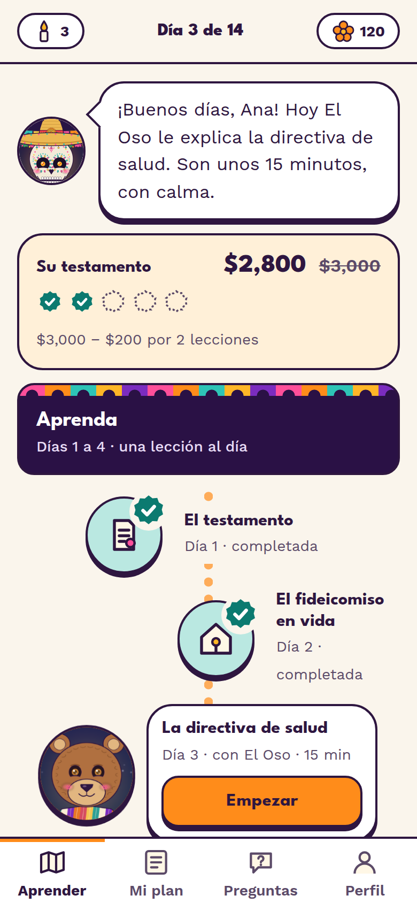
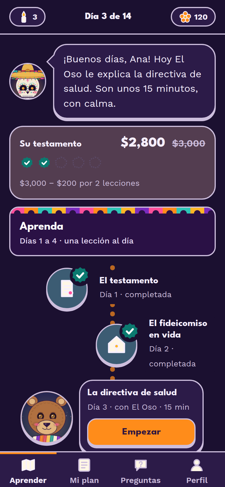
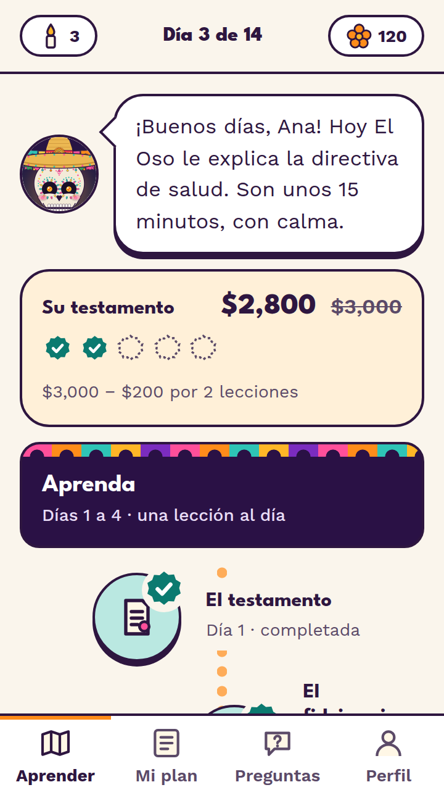
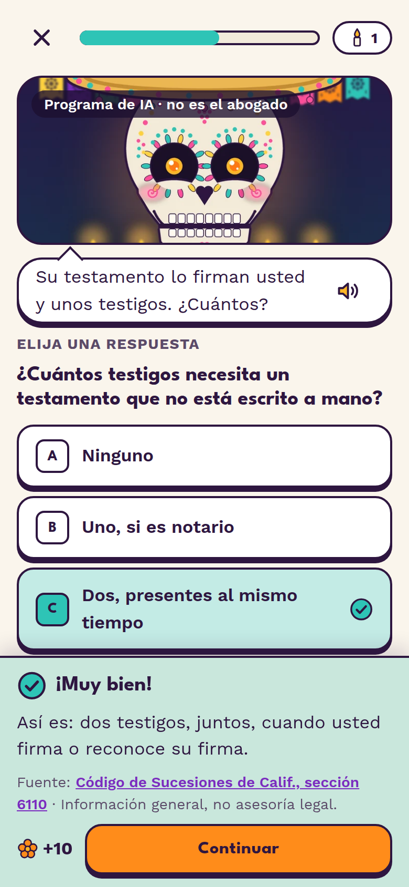
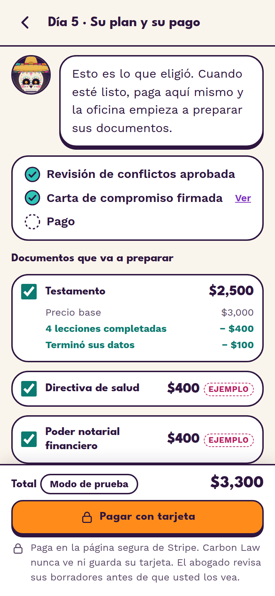
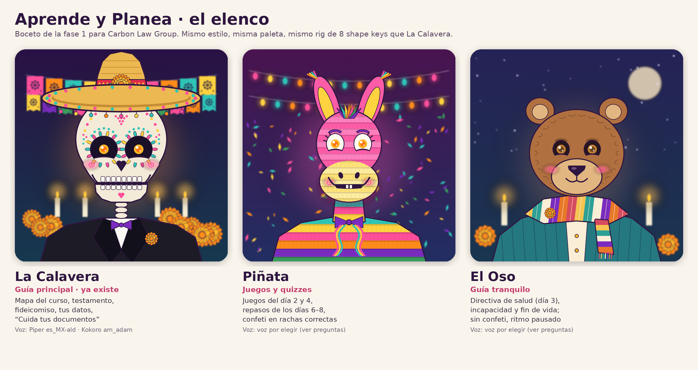
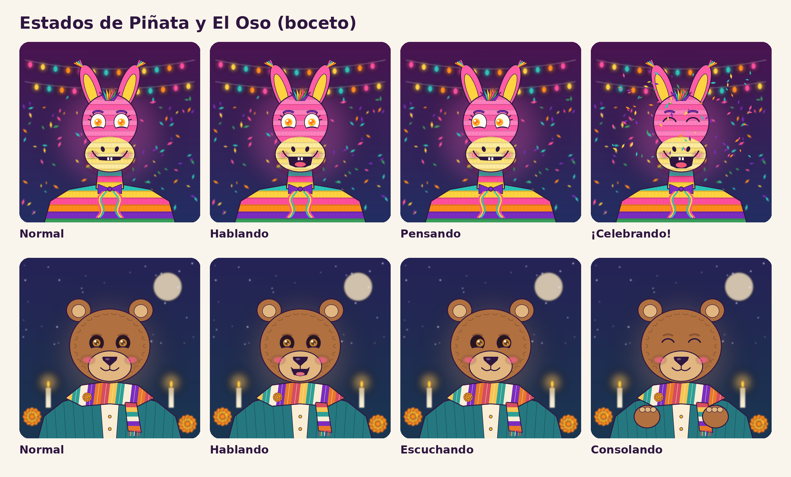

# Aprende y Planea — design system, key screens and characters

Phase 1 deliverable. Status: **draft for Carbon Law's approval**. The tokens and components here are real CSS
(`docs/aprende/screens/tokens.css`); Phase 2 moves them into the app unchanged.

## 1. Direction: *noche de fiesta, papel de casa*

The app has two surfaces and moves between them:

- **La noche** — the deep plum-and-indigo night of La Calavera's backdrop. Characters always appear on it: a stage
  with candles, papel picado, string lights or a moon. It is where the warmth and the play live.
- **El papel** — warm cream paper (`#FAF5EC`) for everything the client reads, answers or signs. It is calm, legible
  and a little like a well-kept family document.

What ties them together is the characters' own drawing style: **every component has the same thick plum outline as
the characters** (`--stroke: 2px` of `#2E1640`) and pressable things sit on a 4 px plum ledge, like a sticker. The
result looks like one illustrated world rather than an app with mascots pasted on, and it is unlike generic
"friendly fintech" UI. The plum outline also gives every control a boundary well above 3:1 contrast.

The firm's own site uses League Spartan and Work Sans; the app uses the same pair so it feels like Carbon Law.
The firm's orange (`#FF4E00`) is close to the marigold used for primary actions, so the brands sit together.

### 1.1 Respect for a serious subject

Two moods, chosen per lesson item by a `sensitive` tag (spec 7.6):

| | **Fiesta** (default) | **Calma** (El Oso, sensitive items) |
|---|---|---|
| Stage | papel picado or string lights | dusk, moon, two candles |
| Feedback | "¡Muy bien!", petals fly up | "Gracias por pensarlo", a soft card |
| Celebration | confetti, Piñata | none; a seal fades in |
| Voice | normal speed | 0.9×, longer pauses |
| Controls | — | pause and "hablemos después" always visible |

Never: lives, hearts, timers, red "wrong" screens, shame copy, flashing.

## 2. Colour

All text pairs below were checked with the WCAG 2.1 relative-luminance formula; the ratios are in the table.

| Token | Value | Use | Text contrast |
|---|---|---|---|
| `--plum` | `#2E1640` | text, outlines, icons (the characters' outline colour) | 14.8:1 on paper |
| `--ink-soft` | `#5B4A68` | secondary text | 7.4:1 on paper |
| `--paper` / `--paper-2` | `#FAF5EC` / `#F2EADB` | page / inset surfaces | — |
| `--card` | `#FFFFFF` | cards, bubbles, options | — |
| `--night` / `--night-2` | `#2A1145` / `#1C2F4F` | character stages, section banners | white 16.6:1 |
| `--marigold` | `#FF8C1A` | primary buttons (plum text), the path | plum 6.9:1 |
| `--gold` | `#FFB627` | price card tint, petals | plum 9.2:1 |
| `--teal` | `#2EC4B6` | correct, progress, done | plum 7.4:1 |
| `--rosa` | `#FF4F9A` | "try again" tint, hearts in art | plum 5.2:1 |
| `--purple` / `--link` | `#7B2CBF` | links, focus ring | 6.5:1 on paper |
| `--marigold-deep`, `--teal-deep`, `--rosa-deep` | `#C2410C`, `#0B7A70`, `#B8205F` | the same hues as text on paper | 4.8, 4.8, 5.7:1 |

Rules: colour never carries meaning alone (correct = teal **and** a check icon **and** "¡Muy bien!"); focus is a 3 px
purple ring offset 3 px; `color-scheme: light dark` with `light-dark()` tokens gives a dark theme for free (screen below).
Forced-colors mode: outlines and borders are real borders, so they survive; the progress bar gets a system-colour fill.

Side note for the firm: on the current public site, white text on `#FF4E00` buttons is 3.3:1, below AA (4.5:1).
Not in this project's scope; mentioned so it can be fixed.

## 3. Type

- **Display:** League Spartan 700/800 — headings, numbers, buttons. **Reading:** Work Sans 400–700. Both self-hosted (latin + latin-ext subsets, `font-display: swap`); no request to Google Fonts in production.
- Base size is the user's own (no root font size is set); `<meta name="text-scale" content="scale">` lets Android/ChromeOS text scaling through.
- Scale: `--step--1` 0.875 rem · `--step-0` 1.0625 rem (body) · `--step-1` clamp(1.25–1.5 rem) · `--step-2` clamp(1.5–2 rem) · `--step-3` clamp(1.875–2.75 rem). Every clamp keeps max ≤ 2.5 × min.
- Line height 1.5 body, 1.15 headings; `text-wrap: balance` on headings, `pretty` on paragraphs; lines capped at 60ch.
- Spanish runs ~20–25 % longer than English: every component is tested with the Spanish strings, no fixed heights on text containers, and `¿`/`¡` are part of the string, never added by CSS.

## 4. Space, shape, depth

4 px rhythm in rem (`--s1` 0.25 rem … `--s7` 3 rem). Radius 1 rem (controls), 1.5 rem (cards), pill for chips.
Depth is the plum ledge (`box-shadow: 0 4px 0 plum`), not blur shadows; pressing a button moves it down 3 px onto its
ledge. Minimum target 48 px (`--tap: 3rem`).

## 5. Iconography, illustration, motion

- **Icons:** 24-unit grid, 1.8 px plum stroke, one flat fiesta fill, round joins — the same language as the characters. Set: vela (streak), pétalo (XP), sello / sello vacío (badges), testamento, casa (trust), salud, llave (power of attorney), pluma (sign), lupa (review), caja (look after), candado, check, pendiente, mapa, plan, pregunta, perfil, volumen, cerrar, atrás. Dark theme: icons need a light-stroke variant (found in the dark render below; ticket T4-07).
- **Illustration:** only the characters and their backdrops. No stock photos, no generic people.
- **Motion:** opt-in under `prefers-reduced-motion: no-preference` (button press, path pulse, petals, confetti, character idle sway). Under reduced motion the character still lip-syncs (it carries speech timing) but does not sway or dance, and celebrations are a static card. Nothing flashes more than three times a second. Screen changes use same-document View Transitions (slide forward/back in the lesson player).

## 6. Components

Each exists in `tokens.css` or is specified for Phase 2 (T2-03, T4-07). States for every interactive one: default, hover, pressed, focus-visible, disabled, and (where relevant) correct / incorrect / done / locked / late.

| Component | Notes |
|---|---|
| Button (primary / secondary / quiet) | marigold + plum text; full width in sheets |
| Icon button | 48 px, always an `aria-label` |
| Chip | streak, petals, "modo de prueba", day |
| Top bar / lesson bar / bottom tabs | tabs: Aprender · Mi plan · Preguntas · Perfil |
| Card, Bubble | the bubble always shows what the character says (captions are not optional) |
| Character stage | three.js canvas on the night surface, "Programa de IA · no es el abogado" label always on it, a `<noscript>`/no-WebGL fallback still image |
| Lesson progress | native `<progress>` fully restyled (guide `progress`) |
| Option (choice) | whole row is the target; key letter; correct shows icon + text |
| Feedback sheet | bottom sheet; source line; "Información general, no asesoría legal" |
| Match tiles, order list | tap-tap matching; order with up/down buttons (keyboard and switch access) as well as drag |
| Listening / speaking | play button with "mostrar texto"; mic button only after consent, typed alternative beside it |
| "Tus datos" composer | chat with the character, type or speak, one question per turn, "saltar" (skip) on every question |
| Price card | price, struck base price, five seals (earned/remaining), "$3,000 − $200 por 2 lecciones" |
| Ledger | the will's discount lines on the payment screen |
| Gate checklist | the conditions for the next step, each with its state |
| Timeline (Mi plan) | 14 rows, date beside each day, done/today/next/late, the reason when a date moved |
| Dialog | native `<dialog>` with `showModal()`, named by its heading, `autofocus` on the safe action |
| Toast | for "Guardado" only; never for errors that need action |
| Switch | reminders and voice settings: `<input type="checkbox" switch>` with role fallback |
| Seal (badge) | notary-seal shape with check; empty = dashed |

## 7. The three key screens

Rendered from the HTML mockups in `docs/aprende/screens/` at 390 × 844 CSS px (iPhone 12-class phone; the design
targets 360 px and up). Copy is draft Spanish for native-speaker and attorney review.

### 7.1 Course map (day 3)

- **Top bar:** the candle (streak 3), "Día 3 de 14", petals (120). Always visible while scrolling.
- **La Calavera hosts:** greets the client by name and says what today is and how long it takes.
- **Price card:** the will's price now ($2,800), the base struck through, the five seals (two earned), and the plain sum. The price is never hidden or spoken by a character.
- **The path:** a marigold-petal trail (the petals that, on Día de Muertos, guide the way home), in four sections with papel picado banners: *Aprenda* (days 1–4), *Firme y pague* (5), *El abogado revisa* (6–8), *Revise, firme y cuide* (9–14). Done days carry a seal; today is large, pulses (motion permitted only), shows its guide (El Oso) and one button; future days are locked with the reason ("se abre mañana", "cuando la oficina apruebe su revisión de conflictos").
- **Bottom tabs:** Aprender · Mi plan · Preguntas · Perfil.

Also rendered: the dark theme (`mapa-dark.png`) and the Chrome side panel at 360 × 640 (`mapa-panel.png`).

 

### 7.2 A lesson with La Calavera (day 1, the will)

- **Lesson bar:** exit (keeps progress), the lesson progress, today's candle.
- **Stage:** La Calavera on his backdrop, with the permanent label "Programa de IA · no es el abogado".
- **Bubble:** what he is saying, word for word, with a replay button.
- **Item:** one question; three whole-row options; the chosen answer shows teal, a check icon and the text "(correcta)" for screen readers.
- **Feedback sheet:** the rule in one sentence, its source (*Código de Sucesiones de California, sección 6110* — a section on the prototype's verified list), "Información general, no asesoría legal", petals earned, Continuar.

### 7.3 Price and payment (day 5)

- **La Calavera** says what this step is, in one sentence.
- **Gate checklist:** conflict review approved, engagement letter signed (with "Ver"), payment pending. The pay button is not reachable until the first two are true.
- **Documents:** each chosen document with its price. The will shows its **ledger** — base $3,000, − $400 for four lessons, − $100 for finishing "Tus datos" — so the discount always says what was earned. Prices the firm has not set yet are marked "ejemplo". The trust, unchecked, says that choosing it turns the will into a pour-over will.
- **Pay bar:** total, "Modo de prueba" while Stripe is in test mode, "Pagar con tarjeta", and the two promises in plain words: the card goes to Stripe's secure page, and the attorney reviews the drafts before the client sees them.

## 8. Characters

### 8.1 The lineup

### 8.2 Shared rules (so the cast looks like one family)

- Flat shapes, the 2 × 0.006 plum outline, the seven-colour fiesta palette from `calavera_art.py`, rosy cheeks with a pink swirl, a grin that curls up at the corners with a dimple, and **sparkly eyes with a smiling lower lid** (gold for La Calavera and Piñata, warm amber for El Oso).
- The same frame: character drawn at `K = 0.86`, `OY = 0.14` in a square, head-and-shoulders, so all three sit at the same size side by side.
- The same rig: each character's art writes the moving-parts map with the calavera's keys (`band, jaw, eyes, socket, pupil, brows, neck`), so a `make_character.py` generalised from `make_calavera.py` gives every one the eight shape keys `jawOpen, blink, mouthRound, browUp, headYaw, headPitch, headRoll, lookX`. Phase 3 adds state keys (`celebrate`, `think`, `wave`, El Oso's `comfort`) the engine treats as optional.
- Art in code (PIL), one command to rebuild: `docs/aprende/characters/pinata_art.py`, `oso_art.py`, shared helpers in `charkit.py`. Phase 3 moves them beside `calavera_art.py` and adds their Blender scripts.

### 8.3 La Calavera (existing; not redesigned)

Kept exactly as built. Phase 3 adds his states (celebrating, thinking, waving, a small happy dance for a finished unit)
and costume variants: reading glasses for the documents walkthrough (day 9), a fountain pen tucked in the pocket for
signing day. Name proposals for the firm to choose (Q-C1): **Don Catrín** (the elegant gentleman counterpart of La
Catrina, and he wears a suit), **Calaquita**, **Don Calavera**.

### 8.4 Piñata

A burro piñata made of layered crepe-paper fringe: a pink head, a yellow muzzle, tall ears with tasselled tips, a
rainbow forelock, a body of rainbow fringe bands, two friendly front teeth, and **a purple paper bow — the same purple
as La Calavera's bow tie**, with streamers. Her backdrop is a fiesta night with string lights and confetti. States:
normal, talking, thinking (eyes to the side), celebrating (eyes closed in a happy arc, mouth open, confetti).
Why she fits: piñatas are the joyful part of a family fiesta; she makes the drills feel like a game without making the
legal content silly. She never appears in calm mode.

### 8.5 El Oso

A big, warm brown bear with round ears and a light muzzle, kind amber eyes with the cast's smiling lower lid, a
gentle closed-mouth smile, a deep-teal cardigan with two gold buttons, and a **sarape-striped scarf with a marigold
pinned to it** — the marigold links him to La Calavera's boutonniere. His backdrop is a calm dusk: moon, a few
stars, two candles, four marigolds; no string lights or confetti. States: normal, talking, listening (eyes to the
side, slight lean), comforting (eyes closed softly, paws up as if offering a hug). Why he fits: a grandparent-like
presence for the hardest conversations; big, slow and safe.

### 8.6 Cultural review (Opus, before release)

- Day of the Dead imagery is used as celebration of family and memory, not horror: no realistic bones, no gore, no dark humour about death. Marigolds, candles and papel picado are used as on an *ofrenda*, warmly.
- No sombrero on Piñata or El Oso (one sombrero in the cast is a character trait; on everyone it becomes a costume stereotype). No moustaches-as-ethnicity, no "accent" in the voices, no Spanglish jokes.
- The sarape and papel picado patterns are generic stripes and cut-outs, not copies of a specific community's textile.
- Names: no diminutives that could read as condescending to older clients (why "Don Catrín" is the first proposal).
- To do in Phase 3: a review by a native speaker from the firm's client community of the names, the lines and the art (Q-C2).

## 9. Platforms

| Surface | Layout |
|---|---|
| Phone (≥ 360 px) | as the screens above |
| Tablet / desktop (≥ 64 em) | left rail instead of bottom tabs; the lesson centred in a 40 em column with the stage beside it |
| Chrome side panel (≈ 320–480 px wide) | the phone layout; the host bubble collapses to one line when height < 700 px so today's lesson stays above the fold |
| Chrome popup (≈ 360 × 480) | no character stage: La Calavera's face, the candle, today's step and one "Abrir" button that opens the side panel |
| Installed PWA | standalone display, the same theme colour as the night surface |

## 10. Modern web guidance applied

The modern-web-guidance skill was consulted (search + local guides) before designing the screens. What it changed:

- **`progress`** — the lesson bar is a native `<progress>` with `appearance: none`, separate `-webkit-`/`-moz-` rules (never grouped), and a label; no ARIA progressbar on a `
`.
- **`motion`** — every animation is opt-in inside `@media (prefers-reduced-motion: no-preference)`, nested in the rule, never a global `animation-duration: 0.01ms`; "keep the final state" so a skipped celebration never leaves content hidden.
- **`respect-os-text-scale` / `typography`** — `<meta name="text-scale" content="scale">`, no root font size, rem everywhere, clamps with max ≤ 2.5× min, no fixed heights on text.
- **`color` / `contrast-color`** — fixed backgrounds use hard-coded contrasting text (checked above); `contrast-color()` is reserved for staff-chosen character accent colours, with the `color(xyz)` fallback.
- **`dialog`** — native `<dialog>` with `showModal()`, named by its heading, `autofocus` on the safe action; no hand-rolled focus traps.
- **`switch`** — `<input type="checkbox" switch>` with the conditional polyfill only when unsupported.
- **`coordinate-global-events`** — appointment times are `Temporal.ZonedDateTime` in `America/Los_Angeles`, with the conditional polyfill.
- **`sanitize-untrusted-html`** — attorney-approved documents and any staff-authored rich text are inserted with `setHTML()` (DOMPurify fallback); model text is always inserted as text, never HTML.

No conflicts between the guidance and the brief were found.
