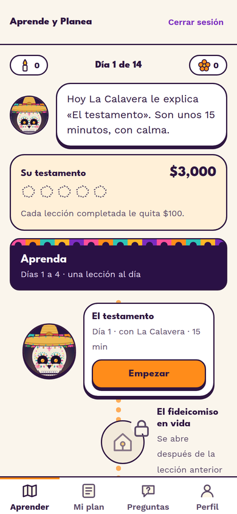
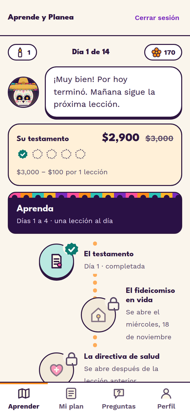
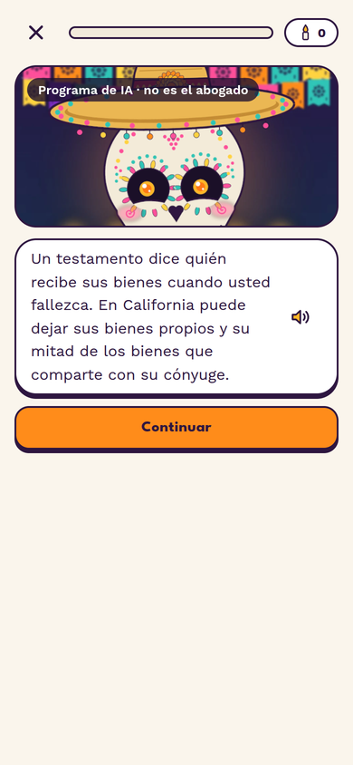
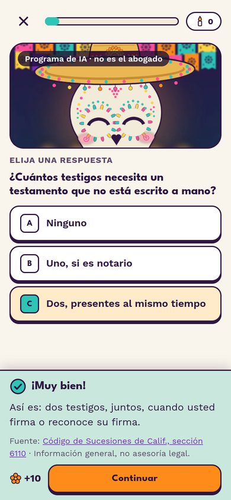
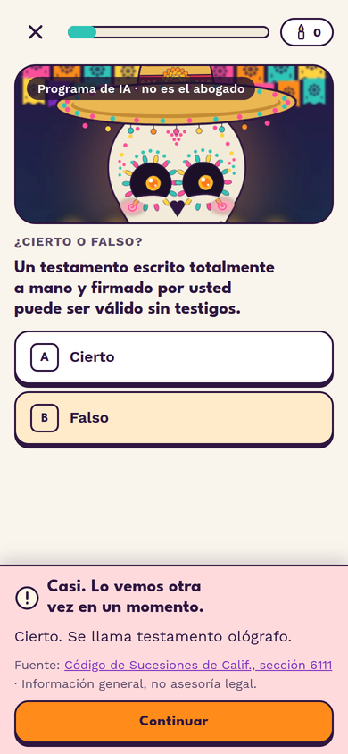
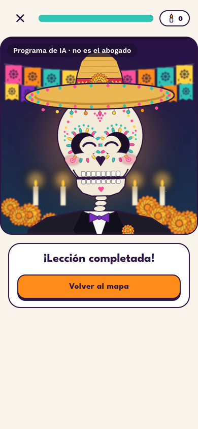
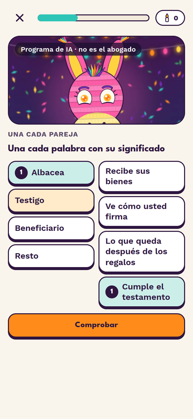
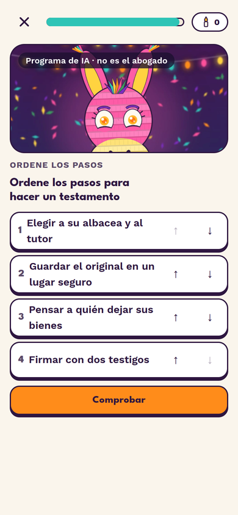
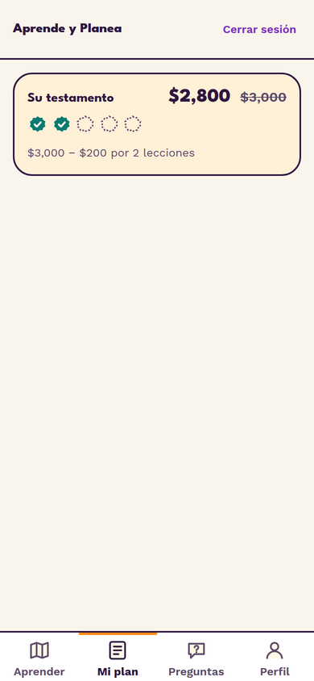

# Aprende y Planea — Phase 4 (Learning) report

Date: 2026-11-18. Status: **complete** (tickets T4-01 to T4-08 merged: #29–#37); T4-09's native-speaker review is with the firm.

## What a client can do now

1. Open the course map: today's lesson, the candle, petals, the will's price and how the discounts work, and every later step of the two weeks with the day it opens.
2. Take a lesson with La Calavera (or El Oso, or Piñata for the games): explanations spoken in the character's voice, then questions of six kinds — multiple choice, scenarios with the fictional Torres family, true/false, match the pairs, put the steps in order, listen and answer.
3. Get feedback on every answer with the rule in one sentence and its official source, linked: "Código de Sucesiones de Calif., sección 6110" opens the statute on leginfo.
4. Finish a lesson: petals, a seal, $100 off the will, the next lesson opening at midnight.

## Screens (390 px phone)

| | | |
|---|---|---|
|  |  |  |
|  |  |  |
|  |  |  |

## Content

- **130 items** in the four core lessons, «Cuide sus documentos» and four bonus lessons (probate, community property, beneficiaries, what to bring to the signing), Spanish and English.
- **111 legal statements**, each citing a Probate Code section read on leginfo on 2026-11-15/16/17/18, or a California Courts self-help page. Plain language: Spanish Fernández-Huerta 77.9, English Flesch 74.8 (target ≥ 70).
- `docs/aprende/lesson-review-packet.md`: every legal statement with its source and an "approve" box, for the attorney. **Nothing is shown to clients until he approves it** — the app publishes a legal item only with an approval of its exact version.

## Verification on `main` (after #37)

- Backend: 178 tests passed (SQLite and Postgres). Prototype `--check`: ok. Content validator: ok.
- Front end: typecheck, lint, i18n (139 keys), 30 unit tests, both builds. Initial JavaScript 21 KB gzipped (three.js loads only with a character).
- Browser tests: 16 passed — sign-up and the shell, the course map, the will lesson (a wrong answer that comes back, sources, resume after reload), match by click, order by keyboard only, the extension; accessibility scans clean.

## Found and fixed

- A new client's first screen asked three endpoints at once and two of them raced to create the journey (a 500 for that client). Fixed with a test that fails on the old code.
- The first learning API bypassed the journey's event path, so discounts would not have been recorded; rewritten.
- The streak said "su vela descansó" even when a second missed day had ended the streak; fixed with tests for every week boundary.
- The dev server forwarded the character files to the characters API, so characters silently fell back to still images in development.

## Needs the firm

- **Q-L2:** the attorney's review of the lessons — the packet is ready.
- **Q-L1:** a native speaker to review the Spanish.
- **Q-P4:** prices for the trust, POA and health care directive (shown as "ejemplo").
- **Q-C1:** La Calavera's name (the app says "La Calavera").

## Next: Phase 5 (Conversation and intake)

Day-1 gate screens (AI disclosure, consent, names-only conflict check), "Tus datos" after each lesson with the character asking the prototype's questions through Beam, the steering checklist, the document choice and the day-4 summary, the timeline engine and late alerts, and the conversation test set. Voice stays on the browser's speech until the firm approves hosting (F-003). The first live Beam calls in Phase 5 cost money; I will ask before running them.
