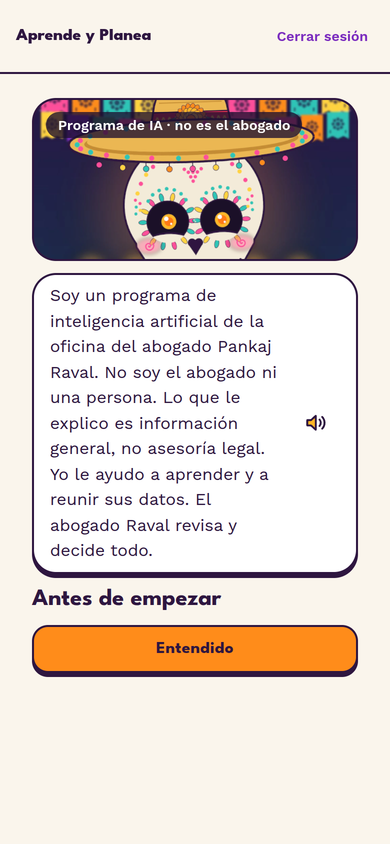
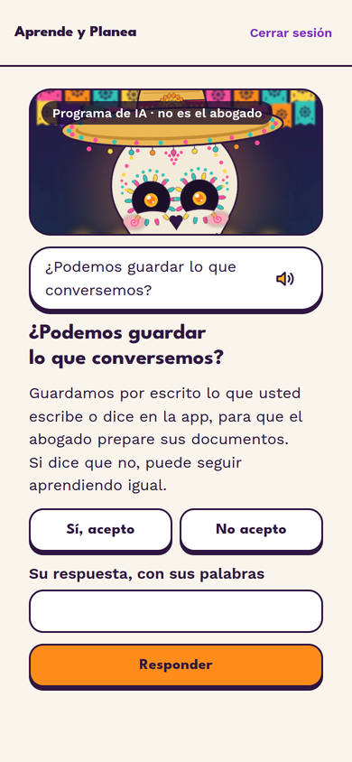
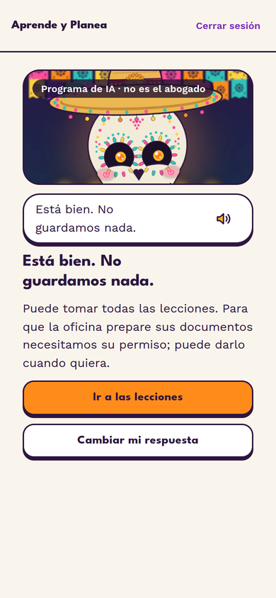
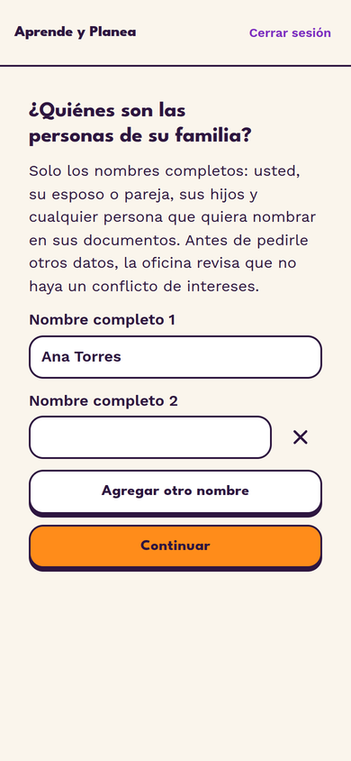
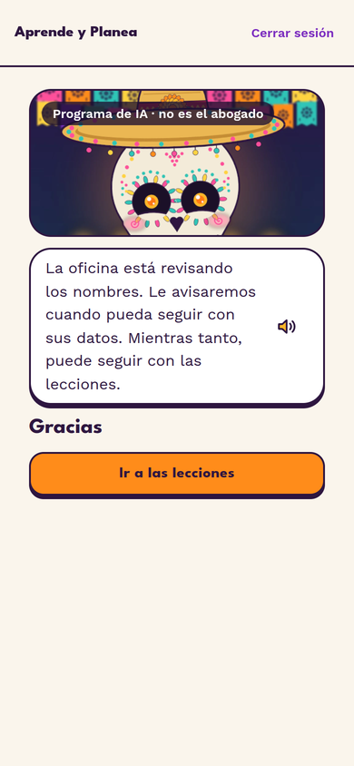
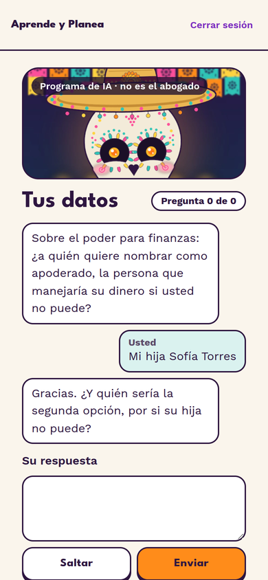
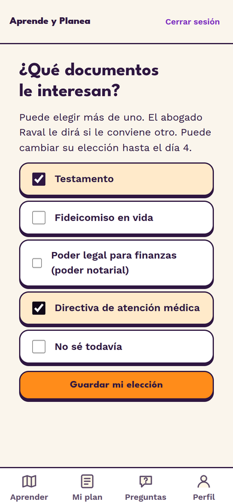
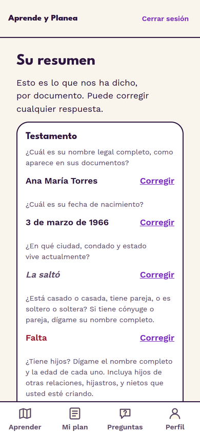

# Aprende y Planea — Phase 5 (Conversation and intake) report

Date: 2026-11-19. Status: **complete**. All nine tickets are merged (#39–#48). T5-06 is reduced by the firm's answer F-003:
no server voice yet. The questions the firm still has to answer are open as decision PRs (#49–#57).

## What a client can do now

1. **Day 1, before anything personal:** La Calavera says it is an AI program from attorney Raval's office, not the attorney
   and not a person, and that the attorney reviews and decides everything. The client agrees to the office keeping what she
   types, in her own words or with a button. "No, no acepto" is a refusal. An unclear answer is asked once more, and unclear
   twice counts as no; she can change it later. After a refusal she can still take every lesson, and nothing is kept.
2. **Names only** for the conflict check. A possible match stops everything with the same neutral "the office is reviewing"
   screen a normal wait shows. The matched names reach staff only, and the staff phone alert carries no names.
3. **Talk with the character** about a lesson. A question about her own case ("¿mi hijo puede ser mi albacea si vive en
   México?") is noted for the attorney and never answered by the AI.
4. **"Tus datos" after each lesson:** the lesson's character asks that document's questions one at a time, and she can skip
   any of them. Her own words are saved; the character's words never are. Finishing the intake earns the fifth $100 off.
5. **Choose documents** on day 2 ("No sé todavía" = all four). **Review everything** on day 4 and correct any answer (each
   change is kept in an audit record). Then **confirm** the documents. Changing them after the attorney approved the scope
   reopens his review and adds one business day.
6. **A dated plan:** every step has a calendar date, allowing for weekends, firm holidays and daylight saving. A firm step
   that runs late alerts staff once.

## Screens (390 px phone)

| | | | |
|---|---|---|---|
|  |  |  |  |
|  |  |  |  |

## Research, and what it changed

Desk research on who lacks a plan and why, the real process from the client's side, and the market and learning evidence:
`docs/aprende-research.md`, with three cited reports. In short:
- People put planning off; they rarely refuse it.
- A calm setting matters more than money off.
- Fear of immigration enforcement and notario fraud are real for this audience.
- Plans most often fail after signing.

What changed:
- **Lessons:** probate is "9 to 18 months", not "at least 9". There is a simpler route for homes of $750,000 or less
  (§ 13151). Fees are figured on the full value, mortgage not subtracted (§§ 10800, 10810). Undated handwritten wills can
  cause doubt (§ 6111(b)). The will lesson opens with "a will is not only for people who have a lot".
- **The characters:** they never ask about immigration status, never sell, and never mention insurance or annuities. They
  frame plans around protecting the family and the home, and they answer "¿son notarios?".
- **The intake questions:** how the house is titled, beneficiary forms, earlier wills, nursing-facility residence, and family
  questions that don't assume marriage.
- **The pilot:** it measures comprehension and attorney minutes. We do not promise attorney time saved: the evidence
  does not show it.

## Verification on `main` (after #48)

- Backend: 380 tests pass (SQLite and Postgres). Prototype `--check`: ok.
- Front end: typecheck, lint, i18n parity (200 keys), 106 unit tests (including the 77-phrase consent table, shared with the
  backend), both builds.
- Browser tests: 22 pass, all clean on the accessibility scans.
- **Conversation test set:** 40 scripted conversations (20 Spanish, 20 English) run through the real chat code with a stub
  model that breaks every rule the server can enforce. The server's guards hold in all 40, and removing one guard makes 40
  of them fail. **The live run against Beam waits for approval (#49).**

## Found and fixed

- The hidden attorney-question tag could leak into what the client sees: the reply guard stopped at the first "?" inside
  the tag. Tags now come off first.
- The conflict check could combine words from two different people into a false match. Each name is now checked on its own.
- A possible conflict could never be released by the firm's own clearance. Now the firm's latest decision wins.
- A builder **deleted the test guard that stops tests from calling the paid model**. It is restored.
- A builder special-cased a holiday to make one test pass. The timeline was rebuilt on one business-day calendar.
- A changed document choice was silently ignored. It is now recorded, and it reopens the attorney's scope review when that
  applies.
- The browser tests timed out on a 20-core desktop with 10 software-rendered 3D pages at once. Local runs are now capped at
  4 workers; CI is unchanged.

## Decisions waiting for the firm (one PR each; merge = as recommended)

| PR | For | What |
|---|---|---|
| #49 | Kevin | The paid live run of the 40 test conversations (about 145,000 tokens) |
| #50 | Attorney | Lesson approval, the day-9 walkthrough, per-client scope, discount wording, signing in the app, the characters' instructions, the 29 questions |
| #51 | Firm | Prices for the trust, POA and health care directive; a payment plan; lesson pace; couples |
| #52 | Firm | The data promise at consent, the State Bar number and "a notario is not a lawyer", retention, a declined-AI path |
| #53 | Firm | Who reviews the Spanish; La Calavera's name; voices; cultural review |
| #54 | Firm | Conflict list and clearance speed, Spanish at signing, hosting, the old portal flow |
| #55 | Kevin | Send the staff questionnaire; run 5–8 client interviews; two extra lessons |
| #56 | Kevin | Keep the CEO overview in the repo |
| #57 | Attorney | The engagement letter, his countersignature before payment, which language governs |

## Next: Phase 6 (payment, documents, appointments) — started

In progress:
- the engagement letter, signed by the client and countersigned by the attorney, with a PDF copy (T6-01)
- booking for consultations and signings (T6-07)
- "Mi plan" with dates (T6-09)

Then, in order:
- checkout against a mocked Stripe (F-004), with payment recorded by the webhook (T6-02, T6-03)
- drafting on payment (T6-04)
- the attorney's review queue (T6-05)
- the client's review (T6-06)
- signing and the final lesson (T6-08)
- my review of drafts for all 16 document combinations (T6-10)
