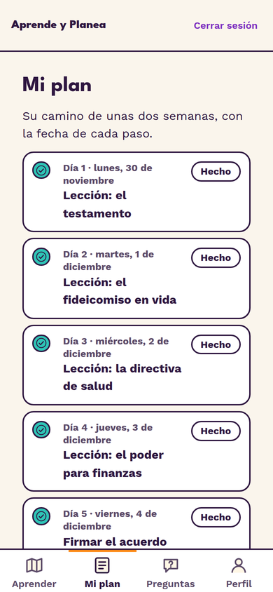
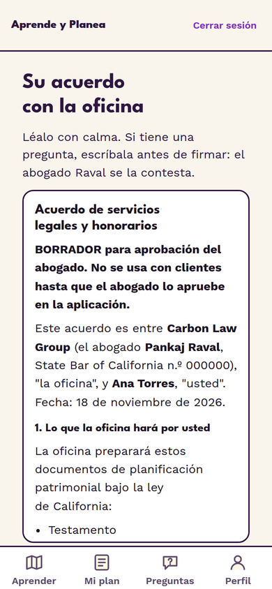
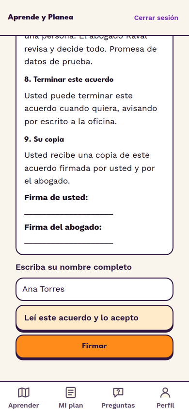
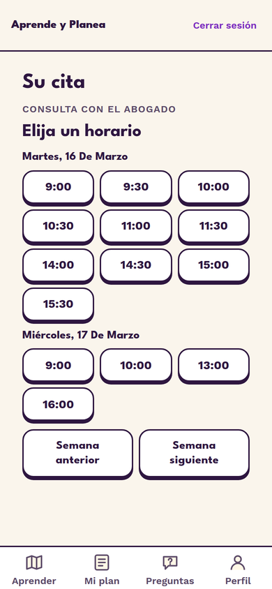
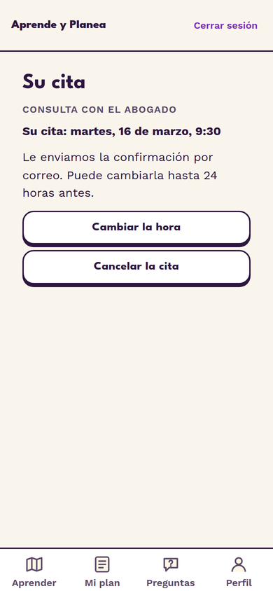
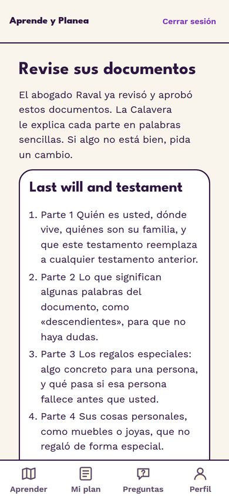
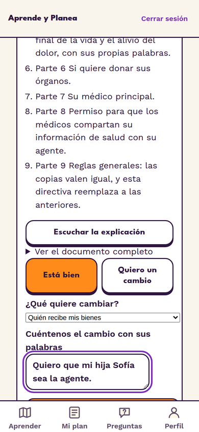
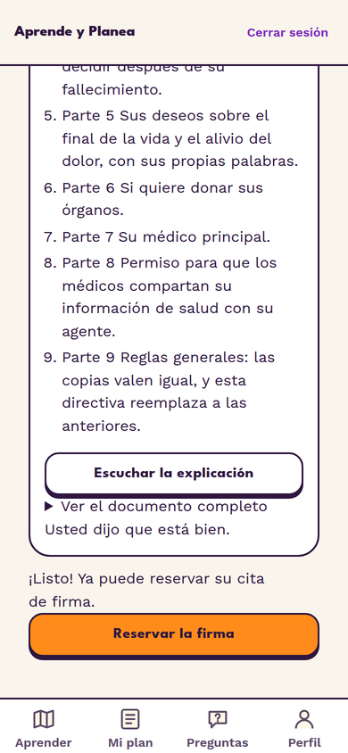
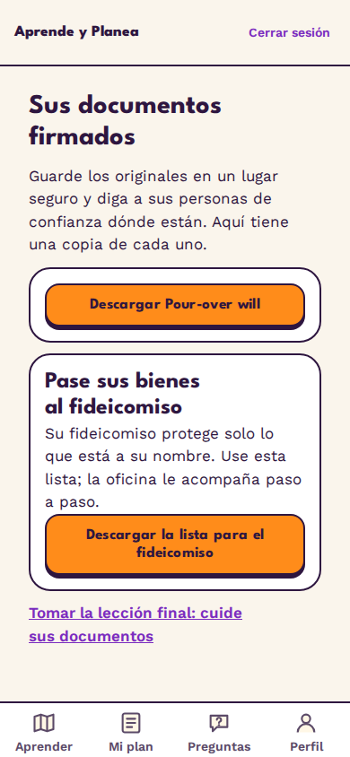

# Aprende y Planea — Phase 6 (Payment, documents and appointments) report

Date: 2026-11-19. Status: **complete**. All ten tickets are merged (#59–#64, #66–#68; T6-02 and T6-03 shipped together in
#62). Payment is test mode only, against a mocked Stripe (F-004). One part is not done: the paid drafting run for the legal
review (T6-10) waits for approval (#65). The cases and the script are merged.

## What a client can do now

1. **See her plan** ("Mi plan"): 14 steps, each with a date. A step that a weekend or holiday moved says so. A late step
   says so calmly, and staff see it in red with an icon, at the top of their client list.
2. **Sign the engagement letter.** The attorney first approves her scope with one click. She reads the letter in her
   language and signs that exact text (checked by SHA-256). The attorney countersigns. Only then can she pay (Bus. & Prof.
   Code § 6148(a): the client gets a copy signed by both). She can download a PDF with the letter, both signatures, the
   times and the hash.
3. **Pay** in test mode. The webhook records each payment once per Stripe session, and the amount must match the stored
   quote. A second delivery of the same event changes nothing. Refunds are recorded.
4. **Drafting starts on payment.** Each document she chose is drafted from her own answers. The drafts cite only
   verified code sections. They are staff-only until the attorney approves them.
5. **The attorney reviews** in the admin page ("Revisión de borradores"). Yellow marks show facts she did not give. He
   cannot approve while an "[ATTORNEY TO COMPLETE …]" item is open. He can download a .docx, upload a corrected version, or
   ask for changes. Only the assigned attorney or an admin can approve.
6. **She reviews** her approved documents (`#/revisar`). La Calavera explains each part in plain words and can read it
   aloud. She can open the full text. For each document she picks "Está bien" or "Quiero un cambio" and chooses one of the
   firm's own change types. A change goes into the firm's change-request records and back to the attorney. Her approved
   version stays in place until he approves the revision.
7. **Book** a consultation (after the four lessons) or the signing (after she confirms every document). Slots are in
   California time. The spring-forward hour, past times and holidays are never offered. Two people can never book the
   same slot. She can change or cancel up to 24 hours before. The confirmation email is in her language. The staff alert
   carries no name.
8. **After signing:** staff upload the executed documents. She downloads them through private links (random 32-byte ids,
   owner only). A trust client gets the firm's funding checklist, filled in with her property. The final lesson opens.
   Funding reminders go out by email at 2, 6 and 12 weeks until staff mark funding done.

## Screens (390 px phone)

| | | | |
|---|---|---|---|
|  |  |  |  |
|  |  |  |  |
|  |  | | |

## Verification on `main` (after #67)

- Backend: 454 tests pass, 2 skipped.
- Front end: typecheck, lint, i18n parity (294 keys), 106 unit tests.
- Browser tests: 31 in 13 files. All pass in CI on every PR.
  - On this desktop, a few 3D-heavy tests can time out when the machine is busy (load average near 38 from other Docker
    stacks). Several worktrees can now test at once on their own ports (`E2E_WEB_PORT`, `E2E_API_PORT`, `E2E_ADMIN_PORT`).

## Found and fixed

Beam builders wrote the first versions. In review, Opus found and fixed these:
- **Bookings were deleted whenever staff saved the office hours.** This was a builder's workaround for a clash in Opus's own
  tests. It is removed. A test now checks that bookings survive an hours change.
- **The drafting job turned off the repeated-text check** so that a stub draft would pass. The check is restored.
- **The approval check blocked every draft.** The notice at the top of each draft names the "[ATTORNEY TO COMPLETE]" mark.
  Only items with text inside the brackets count now. A test covers the notice.
- The engagement letter could crash when it was not ready, accept two signatures at the same moment, or silently approve
  an unknown template. The PDF printed raw markdown. All four are fixed, and the letter renders as text only.
- The payment webhook now checks the amount and ignores a repeated event.
- Change requests had copied logic. The app now has one `record_change_request` and one `send_email`.
- Admin form ids clashed with existing ones, and some fields had no labels.

## Decisions waiting for the firm (one PR each; merge = as recommended)

Unchanged from Phase 5 (#49–#57), plus one new:

| PR | For | What |
|---|---|---|
| #65 | Kevin | The paid drafting run for the legal review: 5 fictional clients, 11 drafts (about 0.3–0.5 M tokens). Opus then reads them all and opens a findings PR. |

Phase 6 depends most on #57 (the engagement letter and the countersignature before payment) and #51 (prices for the trust,
POA and health care directive).

## Next: Phase 7 (staff controls)

1. Content management with attorney approval (T7-01), with the validator in the admin (T7-02).
2. Characters admin (T7-03) and clients admin (T7-04). The attorney's reply appears in the client's Preguntas tab.
3. Firm controls enforced by the server (T7-05): office hours, holidays, retention, switches for AI chat and the extension.
4. Analytics without client content (T7-06).
5. An audit and access-rights matrix over every route (T7-07).
